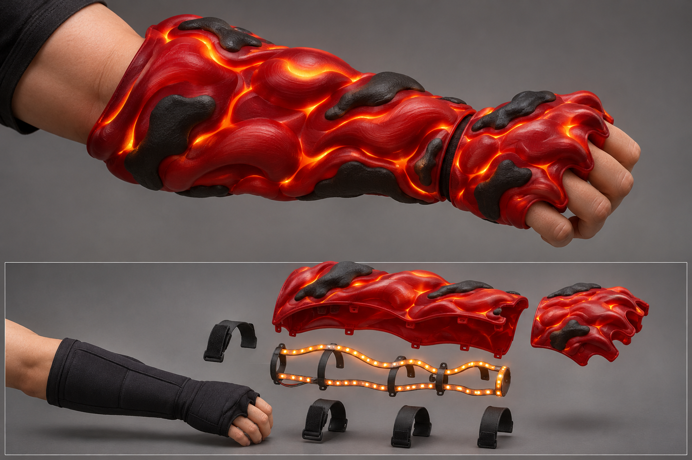

# Cosplay no Japão e protótipo de lava iluminada

Pesquisa em 21 de novembro de 2026, para prototipagem de uso próprio do 3D Sales Japan.

## Alcance da evidência

Foram pesquisados Comic Market C107/C108, World Cosplay Summit (WCS) 2025/2026, Ikebukuro Halloween 2026 e acosta!. A busca não encontrou um censo recente por personagem nesses eventos. As coberturas permitem identificar presença e recorrência, com viés de seleção editorial e maior destaque a personagens femininos. A classificação a seguir usa o gênero do personagem e não o de quem o interpreta. As prioridades de protótipo são avaliações técnicas.

## Personagens femininos com evidência de presença

| Personagem | Sinal observado | Prop que podemos estudar | Viabilidade inicial |
|---|---|---|---|
| Frieren | acosta! e Ikebukuro Halloween 2026 | Cajado desmontável e efeito luminoso removível | Alta para um segmento do cajado |
| Fern | Entrevista conjunta com Frieren no acosta! | Cajado modular, com encaixes ocultos | Alta para ponta e união |
| The Herta (Madame Herta) | WCS 2025/C106, em cobertura sobre a recorrência de Star Rail | Elementos do cajado e detalhes do chapéu | Média, medir peso e volume |
| Mash Kyrielight | Registro no Ikebukuro Halloween 2026 | Escudo modular, com núcleo iluminado opcional | Baixa para escudo completo; média para núcleo |
| Reze | C107 e Ikebukuro Halloween 2026 | Capacete da transformação, após estudar a versão escolhida | Média/baixa; as fotos citadas incluem versões de roupa sem esse prop |
| Hatsune Miku | Ikebukuro Halloween 2026 | Headset iluminado e acessórios de figurino | Alta para um acessório compacto |

Frieren e Fern foram entrevistadas no acosta!. [WEBザテレビジョン](https://thetv.jp/news/detail/1258822/)

The Herta aparece na reportagem que descreve Star Rail como recorrente no WCS 2025 e C106. [MANTANWEB](https://gravure.mantan-web.jp/article/20250831dog00m200028000c.html)

Mash, Miku e Reze aparecem na seleção do Ikebukuro Halloween 2026. NIKKE, Wuthering Waves e Zenless Zone Zero também recebem destaque como franquias. [Famitsu, 01/11/2026](https://www.famitsu.com/article/202611/92750)

Frieren aparece em outra cobertura de Ikebukuro 2026, e Reze também na seleção do C107. [Inside](https://cdn.inside-games.jp/article/2026/11/12/190785.html) · [Movie Walker](https://press.moviewalker.jp/news/article/1319083/)

## Personagens masculinos com evidência de presença

| Personagem | Sinal observado | Prop que podemos estudar | Viabilidade inicial |
|---|---|---|---|
| Denji / Chainsaw Man | Entrevista com participante do WCS 2025 | Carcaça cênica de cabeça ou antebraço, dentes arredondados, luz interna | Média/baixa; começar por uma seção estática |
| Cloud | WCS 2025 e registro de grupo no WCS 2026 | Espada cenográfica modular e detalhes de matérias iluminados | Média para componente; baixa para peça completa |
| Sephiroth | Grupo com Cloud no registro do WCS 2026 | Elementos de traje e espada cenográfica | Baixa para espada completa pelo comprimento |
| Himmel | Entrevista no C108 junto com Frieren | Guarda e pomo de espada, com lâmina cênica leve | Média |
| Gojo Satoru | Registro na cerimônia de Ikebukuro 2026 | Efeito removível de energia para fotografia | Alta para módulo de luz; menor dependência de props no traje |

O participante entrevistado como Chainsaw Man relata cerca de um mês de produção. Esse caso individual ajuda a dimensionar o esforço, mas não estabelece prazo para o projeto. [grape](https://grapee.jp/2065811)

Cloud aparece no WCS 2025. A transmissão do WCS 2026 lista um grupo de Reno, Cloud e Sephiroth em 25:53. [Cobertura WCS 2025](https://news.livedoor.com/article/detail/29289179/) · [Transmissão WCS 2026, DAY2](https://www.youtube.com/watch?v=uE0oZjr8fEw)

Himmel e Frieren aparecem nas entrevistas do C108. Gojo aparece na cerimônia de Ikebukuro 2026, o que confirma uma ocorrência específica. [C108, entrevistas DAY2](https://www.youtube.com/watch?v=yQp5k6u8l-g) · [4Gamer](https://www.4gamer.net/games/817/G081722/20261101004/)

## Escolha por oportunidade de prop

1. Frieren/Fern — melhor primeiro teste de montagem de peça grande a partir de módulos. Criar uma ponta e um acoplamento antes de fazer o cajado inteiro.
2. Miku — headset ou pequeno adereço iluminado para estudar peso, fixação e uso próximo do corpo.
3. Cloud — módulo de matéria luminosa ou detalhe de guarda antes de ampliar para uma espada.
4. The Herta/Mash — mais espaço para modelagem e luz, com maior custo em peso, embalagem e acabamento.
5. Denji/Reze transformados — boa demonstração de carcaças e efeitos, mas ajuste à cabeça e regras de eventos elevam a dificuldade.

Essa ordem é uma recomendação de prototipagem. Presença em reportagem não mede procura por encomendas, e uma versão popular sem prop não garante demanda pelo acessório de outra versão. Para estimar frequência, a próxima rodada precisa amostrar galerias com método uniforme, registrar versão e prop e deduplicar participantes fotografados várias vezes.

## Akainu — lava que parece se mover

### Direção visual de 23 de novembro de 2026

O proprietário forneceu três referências do anime e propôs magma mais vermelho sobreposto ao braço. O conceito passa a usar volumes arredondados de magma vermelho, ilhas de crosta preta e regiões luminosas laranja. A imagem abaixo é uma visualização gerada para orientar o desenho. Encaixes, fixações e circuito precisam de desenvolvimento.

Proposta de construção: cascas removíveis divididas em segmentos compatíveis com o volume da A1 mini, com peça do dorso da mão separada do antebraço e folga para o punho. Testar uma pequena amostra de material translúcido com pintura vermelha translúcida e áreas pretas opacas antes de escolher o acabamento. Medir transmissão de luz, aderência e aparência do material com a luz desligada. Usar LEDs endereçáveis com gradientes que percorrem as regiões luminosas. O primeiro ensaio permanece em bancada, seguido por uma placa de antebraço.

O usuário propôs reproduzir o efeito de magma do Sakazuki/Akainu. A ficha oficial confirma a habilidade Magu Magu no Mi. A pesquisa atual não demonstrou que Akainu esteja entre os personagens mais usados nos eventos examinados. Ele é um candidato técnico para demonstrar o efeito. [ONE PIECE oficial](https://one-piece.com/character/Sakazuki/index.html)

### Primeiro módulo proposto

Construir uma placa curva removível de antebraço, mantendo punho e cotovelo livres. Dimensões serão definidas pela medida do usuário. O conjunto teria:

- Casca com relevo de rocha escura e canais irregulares.
- Difusor translúcido por trás das fissuras.
- Pequenos segmentos de LEDs RGB endereçáveis acompanhando canais ramificados.
- Suporte interno separado da pele, com forro, passagem de ar e fixação de retirada rápida.
- Microcontrolador e alimentação removível, com chave acessível, alívio de tração e conectores protegidos.

PLA serve para ensaios de textura e difusão em bancada. PETG é candidato para a estrutura vestível. Testar PLA natural, PETG translúcido ou TPU translúcido como difusores, escolhendo conforme a dispersão, espessura e facilidade de montagem medidas. EVA ou tecido pode formar o revestimento interno. Todos os materiais e encaixes permanecem em avaliação.

### Animação luminosa proposta

Mapear a posição dos LEDs por ramificação. Manter vermelho escuro de fundo e deslocar regiões laranja e amarelas ao longo dos canais com transições suaves. Usar velocidades diferentes, pequenas variações de brilho e áreas que escurecem lentamente. Um botão alterna repouso, fluxo e pulso de ativação. O efeito de movimento viria da sequência luminosa.

Prever modo de luz fixa para fotos e ajustar brilho para ambiente claro, ambiente escuro e gravação de celular. Validar filmagem para identificar cintilação e pontos de LED aparentes. No exterior durante o dia, a impressão de fluxo pode ser muito mais discreta.

### Eletrônica e testes

A arquitetura inicial pode usar LEDs de 5 V e controle por microcontrolador. Selecionar os componentes antes de dimensionar fonte, fios e proteção. Para um controlador de lógica 3,3 V e LEDs de 5 V, seguir a recomendação de conversão de nível lógico do fabricante. Ensaiar o circuito em bancada antes de vestir.

Medir consumo nos modos previstos, temperatura no lado interno, peso e autonomia. Limitar corrente e brilho, verificar a distribuição de alimentação e usar proteção elétrica apropriada. A orientação da Adafruit aborda resistor de dados, capacitor, referência de terra e ventilação dos LEDs. Para uso vestível, recomenda segmentos curtos apoiados em base semirrígida ou pixels próprios para costura. [Adafruit, práticas elétricas](https://learn.adafruit.com/adafruit-neopixel-uberguide/best-practices) · [Adafruit, tiras vestíveis](https://learn.adafruit.com/adafruit-neopixel-uberguide/neopixel-strips)

Começar com um cupom de textura e difusor, depois uma placa de antebraço. Expandir para mão, ombro ou tronco somente após comprovar conforto, liberdade de movimento, temperatura e retirada rápida. Registrar custos, tempo de impressão e acabamento para cada etapa.

## Uso em evento e eventual venda

As regras variam por organizador e edição. A Comiket C108 restringe baterias grandes, réplicas e circulação com capacetes que limitam a visão. A compatibilidade deve ser conferida para o evento de destino. [Comiket C108](https://comiket.co.jp/info-a/TAFO/C108TAFO/cosplay.html)

A fase atual é de testes de uso próprio. Antes de comercializar reproduções de personagens, avaliar direitos sobre design e arquivos utilizados, além do enquadramento migratório e fiscal. A pesquisa não estabelece autorização comercial dos titulares.
