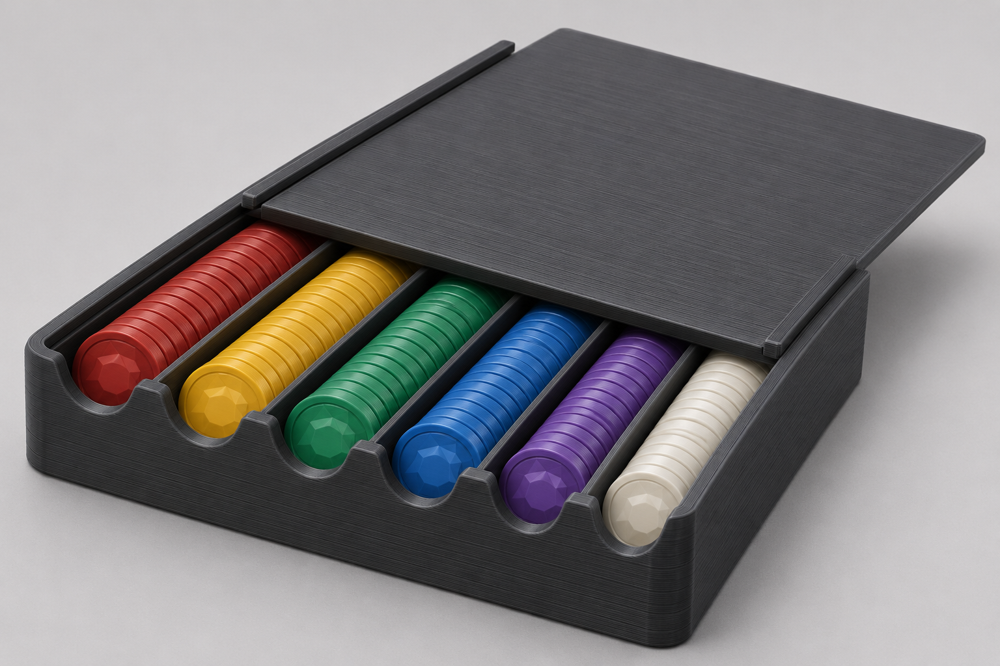
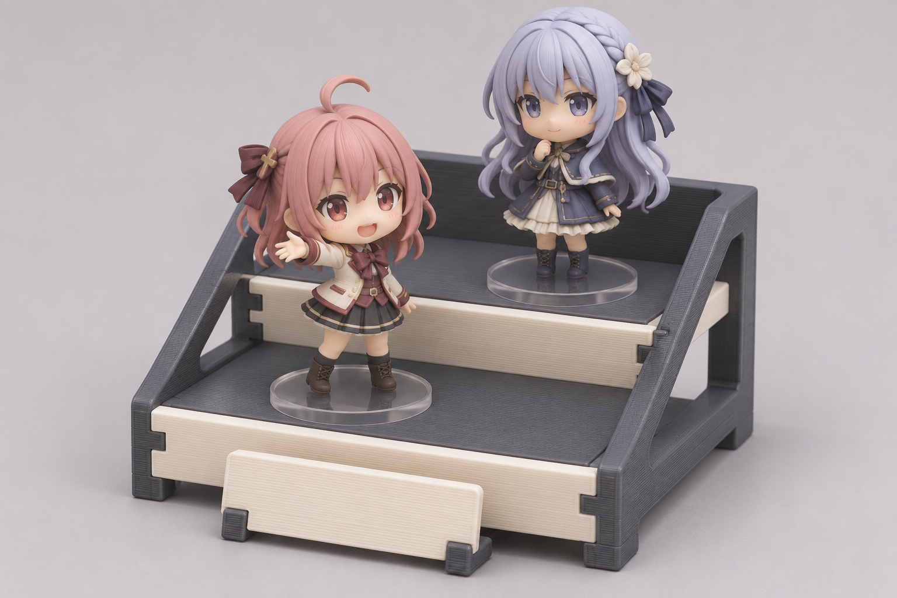
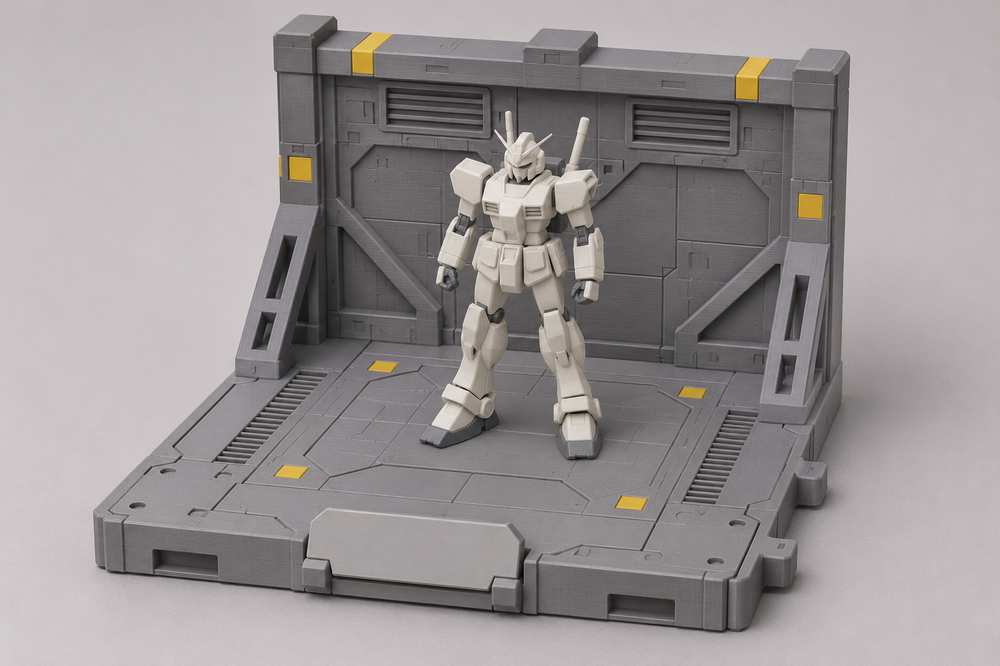
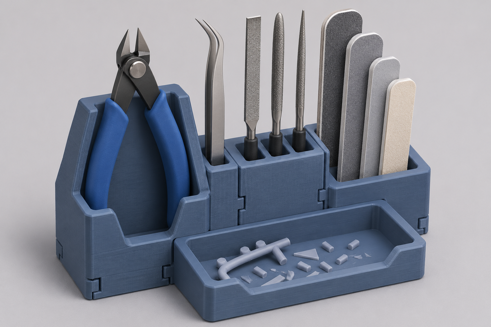

# Conceitos de produto para impressão FDM

Propostas visuais de 14 de novembro de 2026, derivadas da [pesquisa Market Research JP](MARKET_RESEARCH_JP_2026-11-14.md). As imagens são renders conceituais. Dimensões, encaixes, acabamento e capacidade de carga dependem de protótipos físicos.

## Bandeja de fichas para Splendor

Seis canais com abertura para os dedos e tampa deslizante. A imagem ilustra o conjunto. O primeiro CAD deve ter apenas um canal para testar a geometria com as fichas da edição japonesa revisada.

- **Material recomendado.** PLA Basic para corpo e tampa, pela rigidez e facilidade de iterar nas folgas. Testar PETG se o trilho precisar de uma trava flexível ou se o teste de transporte indicar necessidade de maior tolerância térmica.
- **Sob encomenda.** Boa ideia para testar demanda no BOOTH antes de montar estoque. Com vendas regulares da versão padrão, um lote pequeno pode reduzir espera e trabalho por pedido.
- **Teste decisivo.** Verificar retirada com uma mão, fechamento, retenção das fichas na vertical e folga na caixa.

## Expositor para figures chibi

Dois níveis para figuras de cerca de 100 mm sobre suas bases originais, com plaqueta removível e opção de cor. A compatibilidade depende da largura e profundidade das bases e da pose.

- **Material recomendado.** PLA Matte para degraus e plaqueta, em uso interno. Testar deslizamento, marcas de contato e estabilidade com as bases reais.
- **Sob encomenda.** Sim, especialmente para a plaqueta com nome e as combinações de cores. Padronizar as peças estruturais para reduzir configuração e retrabalho.
- **Teste decisivo.** Verificar estabilidade com apenas a figura no degrau superior, folga entre as figuras e facilidade de troca da plaqueta.

## Hangar modular para Gunpla HG 1/144

Piso com textura industrial, junção lateral para módulos e plaqueta frontal. A imagem inclui uma parede opcional. O primeiro protótipo pode começar com piso e plaqueta.

- **Material recomendado.** PLA Matte para piso, parede e plaqueta. Testar PETG para conectores removíveis caso os testes de montagem indiquem quebra ou desgaste.
- **Sob encomenda.** Sim, para combinações de piso, parede e placa. Limitar inicialmente o número de módulos por pedido até medir tempo de máquina e embalagem.
- **Teste decisivo.** Verificar empenamento do piso, continuidade entre módulos e espaço para as bases originais em dois kits HG.

## Organizador modular de bancada

Blocos que se encaixam para ferramentas e bandeja rasa para recortes. O render mostra ferramentas voltadas para cima. No CAD, prever alojamento que proteja pontas e mantenha o alicate fechado.

- **Material recomendado.** PETG para os módulos de uso frequente, sujeito a teste de encaixe e de queda. Começar com amostras de um único encaixe para ajustar folgas antes de imprimir o conjunto.
- **Sob encomenda.** Faz sentido para módulos avulsos e configurações de ferramenta. Se um kit padrão ganhar giro e o tempo medido justificar, manter poucas unidades prontas.
- **Teste decisivo.** Retirar cada ferramenta com uma mão sem arrastar ou tombar a base. Conferir o encaixe com ferramentas de dimensões diferentes.

As escolhas de filamento são recomendações para teste. As propriedades variam conforme a formulação. A [ficha comparativa da Bambu Lab](https://cdn1.bambulab.com/filament/filament-guide/bcv8wbl4hj/filament-guide-en.pdf) serve de referência para PLA e PETG HF.

## Produção após confirmação de pagamento

**BOOTH.** O canal documenta como configurar vendas sob encomenda na modalidade de envio pelo vendedor. Informar a modalidade e o prazo de expedição na página. [Orientação do BOOTH](https://booth.pixiv.help/hc/ja/articles/231284068)

**Mercari Japão.** A plataforma proíbe anunciar produtos que o vendedor ainda não tem em mãos. Para esse canal, produzir e inspecionar a unidade antes de anunciar. [Regra da Mercari](https://help.jp.mercari.com/guide/articles/866/)

Com 5–10 horas semanais disponíveis, manter uma amostra aprovada de cada modelo oferecido e medir impressão, acabamento e embalagem antes de prometer prazo. Contabilizar fila, margem para uma reimpressão e dias de postagem. O limite inicial de pedidos deve caber nessa capacidade medida. Para peças personalizadas, confirmar texto, cor e configuração antes de começar a impressão. A compra da impressora e os testes físicos permanecem pendentes.
