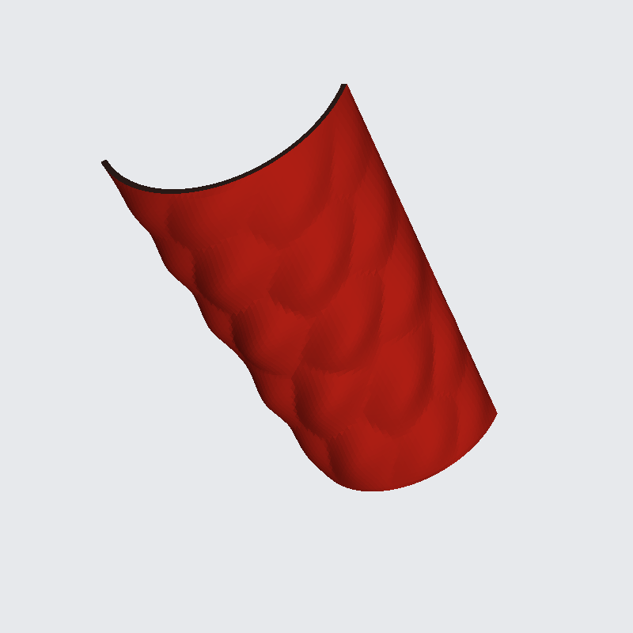

# Casca de magma — protótipo geométrico v1

Criado em 23 de novembro de 2026. Modelo inicial com volumes orgânicos sobre uma casca curva, baseado no conceito de antebraço de magma. Dimensões provisórias para avaliação em bancada.

## Arquivos

- `forearm_concept.stl` e `.obj` — casca de 150 mm de comprimento, aproximadamente 84,57 mm de largura e 36,52 mm de altura. Arco de 140 graus, raio interno variando de 30 a 43 mm. Aberta nas laterais e extremidades, com parede fechada em toda a borda.
- `magma_sample.stl` e `.obj` — amostra de aproximadamente 40,11 × 50 × 14,09 mm para começar os testes.
- `generate.py` — gerador editável em Python com NumPy. Executar `python models/akainu/generate.py` a partir da raiz. Os parâmetros estão no final do script.
- `validation.json` — dimensões, volumes e verificações de fechamento da malha.

As duas malhas passaram na verificação de triângulos não degenerados, duas faces por aresta, orientação consistente e topologia fechada. A impressão física e a validação no fatiador permanecem pendentes.

## Como testar

Importar primeiro `magma_sample.stl` no Bambu Studio usando unidades em milímetros. Conferir dimensões, orientação, apoios, suportes e consumo na prévia de camadas. A superfície interna é curva, portanto pode exigir suportes conforme a orientação. Começar com PLA disponível para avaliar geometria; depois experimentar material translúcido para luz.

STL e OBJ contêm geometria sem pintura. O vermelho da prévia é ilustrativo. A malha possui relevos sólidos com vales entre os volumes; a espessura varia de 2 mm até cerca de 9 mm. A difusão de luz precisa de ajuste de espessura após teste. As crostas pretas podem ser estudadas por pintura ou peças adicionais.

O modelo ainda precisa de ajuste anatômico, bordas de contato suavizadas, fixações, alojamentos de LED e desenvolvimento da peça da mão. O relevo é uma aproximação procedural inicial do conceito. Para a versão vestível, medir comprimento útil, circunferência do punho e circunferência máxima do antebraço, além de reservar espaço para forro e eletrônica.
