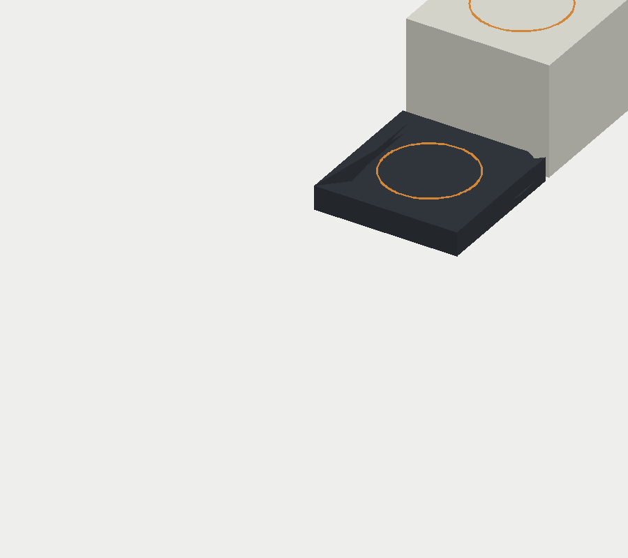

# Expositor para duas figures de 55 mm

Modelo inicial de 25 de novembro de 2026. Medidas informadas pelo proprietário: altura aproximada de 55 mm, base circular de 30 mm e saliência de 1–2 mm na região mediana. Foi adotado envelope provisório de 36 mm para cada figura, cobrindo uma interpretação conservadora de saliência em ambos os lados.

## Arquivos

- `chibi_display.FCStd` — modelo editável no FreeCAD. A planilha `Dimensoes editaveis (mm)` controla largura, profundidade, paredes, espessura superior e alturas. Alterar os valores da coluna B e recomputar o documento. A exportação dos STL precisa ser repetida após alterações.
- `chibi_front_print.stl` — módulo baixo, 48 × 48 × 8 mm.
- `chibi_rear_print.stl` — módulo alto, 48 × 48 × 38 mm.
- `generate.py` — fonte executável pelo Python incluído no FreeCAD, com NumPy e Pillow.
- `validation.json` — dimensões e volumes calculados.

Cada módulo é uma peça separada, com superfície superior plana, paredes de 2,4 mm, teto de 3 mm e abertura inferior. A figura permanece sobre sua base original. Os círculos da prévia são referências ilustrativas; não existem rebaixos circulares no modelo. Os módulos podem ser colocados lado a lado, em diagonal ou em degraus. A disposição em degraus ocupa aproximadamente 48 × 98 mm, incluindo folga de 2 mm entre módulos. Não há travamento entre eles nesta versão.

## Primeira impressão

Importar primeiro o módulo baixo no Bambu Studio, conferir A1 mini, bico, placa e perfil PLA. Os STL já foram exportados com a superfície superior plana voltada para a mesa e a cavidade para cima, permitindo avaliar impressão sem suportes. Conferir essa orientação na prévia. A face da placa ficará como acabamento superior de uso.

Para bico de 0,4 mm confirmado, começar com perfil padrão de 0,20 mm e conferir as paredes e camadas superiores no fatiador. Imprimir um módulo por vez. Cor proposta: módulo baixo preto e alto branco, ou ambos pretos conforme preferência. As cores são definidas pelo filamento escolhido.

Colocar a figure no primeiro módulo e verificar folga, contato da base, deslizamento e estabilidade antes de imprimir o segundo. Após completar ambos, ajustar a posição para que as figuras fiquem visíveis. Pequenos pés antiderrapantes podem ser avaliados se deslizarem.

Os sólidos CAD foram verificados e o documento salvo e reaberto. As malhas STL foram verificadas como fechadas. A validação física e a inspeção no Bambu Studio seguem pendentes. O volume total de 31.334,4 mm³ equivale a aproximadamente 38,9 g de PLA maciço com densidade hipotética de 1,24 g/cm³. O consumo do fatiador depende do perfil, preenchimento e purga. Usar o valor mostrado nele para planejar o filamento.
